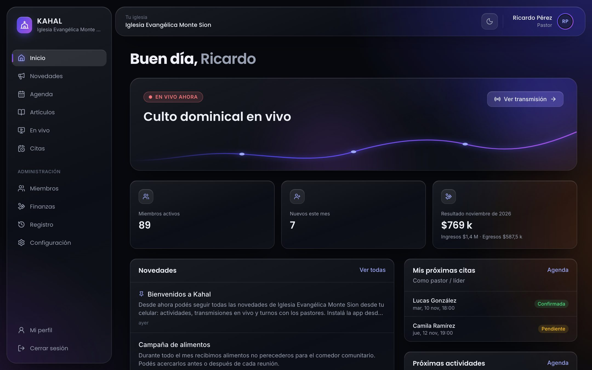
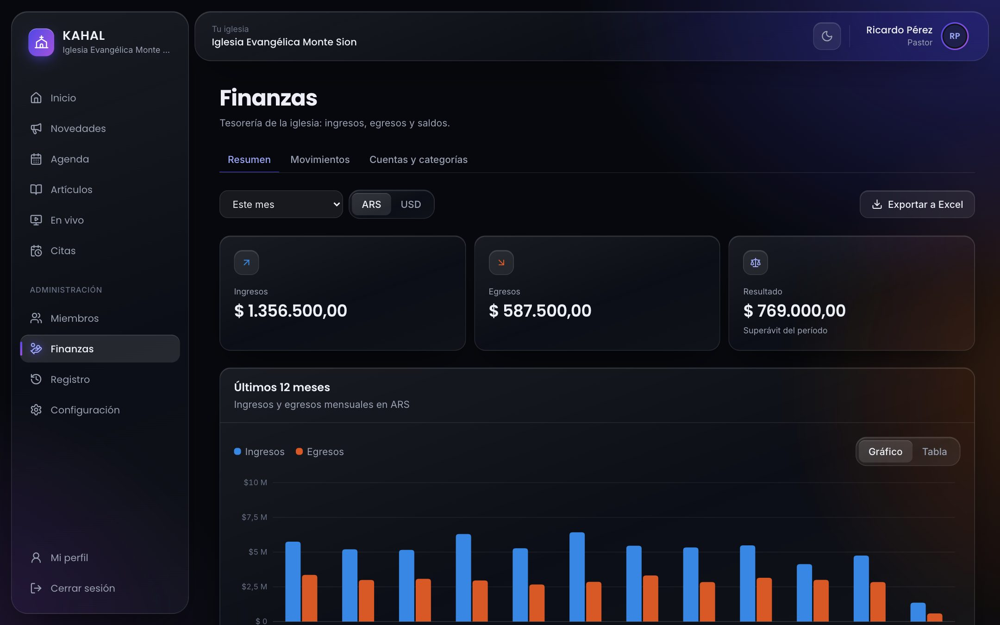
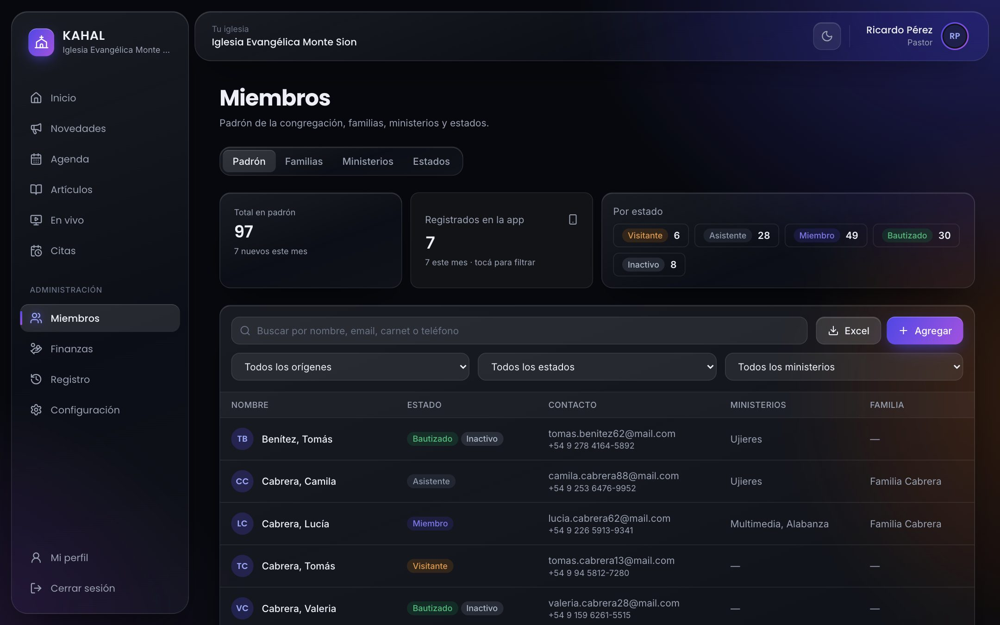
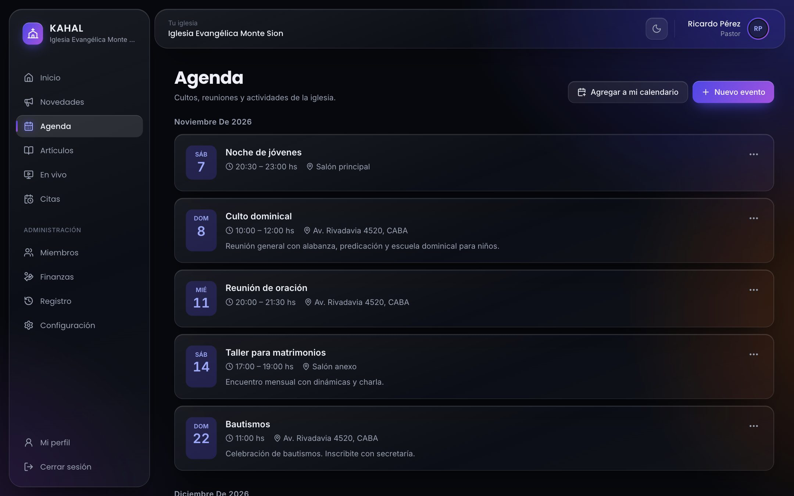
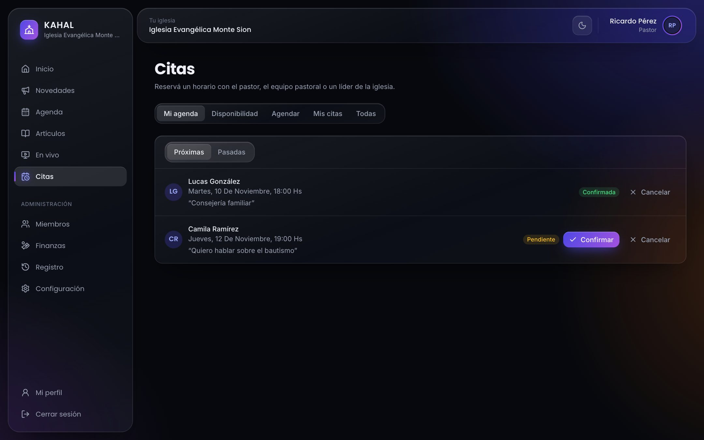
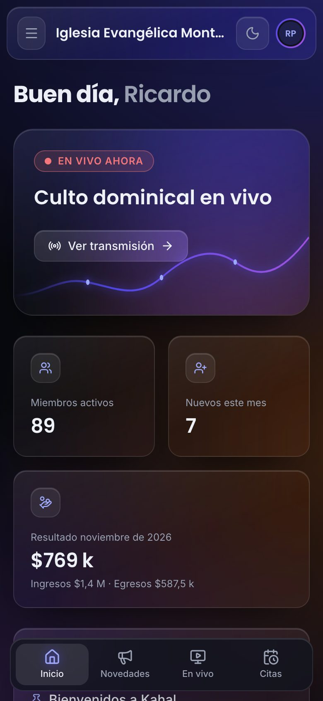
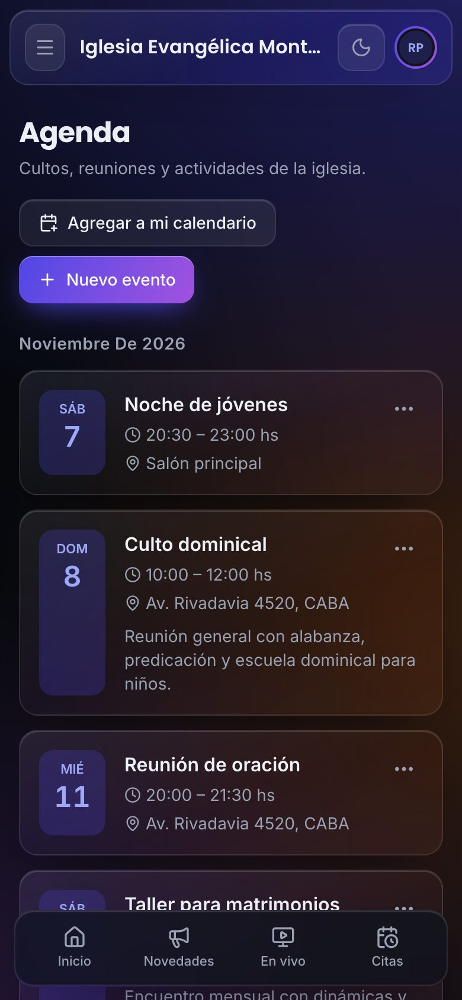
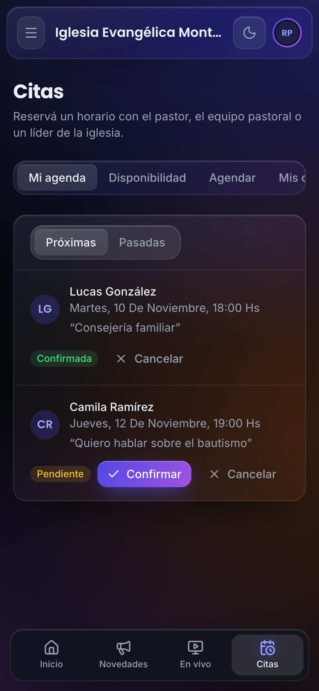
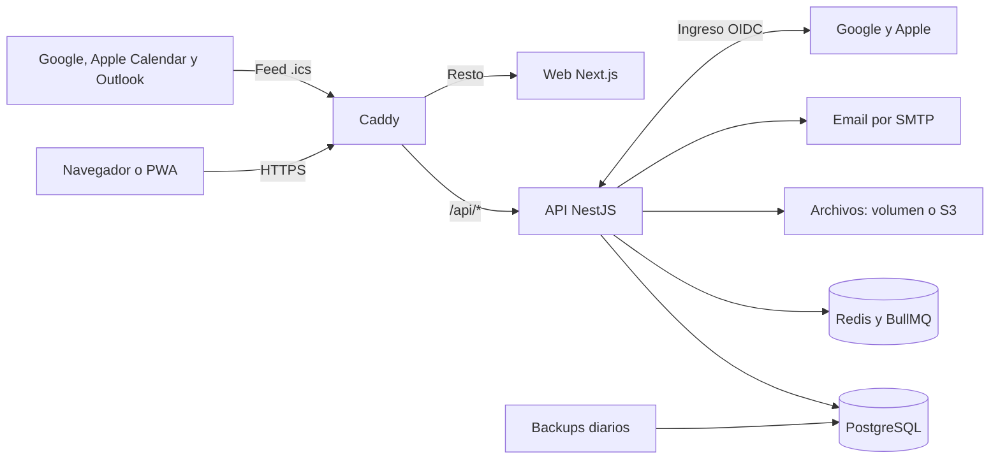

<p align="center">
  
</p>

<p align="center">
  <strong>La plataforma para administrar tu iglesia y mantener conectada a tu congregación.</strong><br>
  Finanzas, membresía, agenda, transmisiones y citas pastorales, desde la computadora o el teléfono.
</p>

<p align="center">
  
  
  
  
  
  
</p>

<p align="center">
  <a href="#-funcionalidades">Funcionalidades</a> ·
  <a href="#-un-vistazo">Capturas</a> ·
  <a href="#-una-experiencia-para-cada-persona">Roles</a> ·
  <a href="#-stack-tecnológico">Stack</a> ·
  <a href="docs/INSTALACION.md">Instalación</a>
</p>

<br>

<p align="center">
  
</p>

## ✨ ¿Qué es Kahal?

**Kahal** (קהל) significa *congregación* en hebreo. Reúne en una sola app lo que muchas iglesias llevan repartido entre hojas de cálculo, grupos de chat y cuadernos: la tesorería, el registro de miembros, los anuncios, la agenda y las citas con el pastor.

Una misma instalación atiende a muchas iglesias, cada una con sus datos aislados, su logo, su color y su propia forma de organizarse. Los miembros se unen escaneando un código QR y tienen la iglesia en el teléfono, sin pasar por ninguna tienda de aplicaciones.

<table>
  <tr>
    <td width="33%" valign="top"><strong>⛪ Para quienes lideran</strong><br>Una mirada clara de la congregación y de las finanzas, con la tarea repartida según los roles que definas.</td>
    <td width="33%" valign="top"><strong>📱 Para la congregación</strong><br>Novedades, actividades, cultos en vivo y citas pastorales, siempre a mano.</td>
    <td width="33%" valign="top"><strong>🚀 Para quien la instala</strong><br>Un solo stack de Docker, con HTTPS automático, migraciones y backups diarios.</td>
  </tr>
</table>

## 🧩 Funcionalidades

### 💰 Finanzas
- Ingresos y egresos en cuentas en **ARS y USD**, con categorías propias.
- **Diezmos asociados a cada miembro** y comprobantes adjuntos a cada movimiento.
- Resumen por período con gráfico de los últimos 12 meses.
- **Exportación a Excel** con resumen, movimientos, totales por categoría y por mes, y diezmos por miembro.

### 👥 Membresía
- Registro de miembros con búsqueda y filtros por estado, ministerio y origen, exportable a Excel.
- **Familias y ministerios**, con líder por ministerio.
- **Estados a medida**, con nombre y color, y varios a la vez por persona (por ejemplo, Miembro y Bautizado).
- La ficha de cada persona está sincronizada con su cuenta: lo que edita en *Mi perfil* y lo que edita la iglesia es lo mismo.

### 🔔 Notificaciones push
- Avisos en Android y iPhone de novedades, eventos, transmisiones en vivo y citas.
- Cada persona las activa en su dispositivo desde *Mi perfil*. En iPhone hace falta iOS 16.4 o posterior y agregar Kahal a la pantalla de inicio.

### 📲 Registro con QR
- **Código QR fijo por iglesia**, descargable en PNG o SVG e imprimible como cartel A4.
- Registro en dos pasos, sin aprobación manual, con consentimiento de datos personales (Ley 25.326).
- La sesión queda iniciada y se renueva sola: solo vence tras 180 días sin abrir la app.

### 🔑 Ingreso con Google y Apple
- Registro e ingreso sin contraseña, o con contraseña si la persona lo prefiere.
- Cuentas de Google y Apple conectables desde *Mi perfil*.
- Es opcional: los botones aparecen cuando la instalación tiene configuradas las credenciales.

### 📅 Agenda y calendario personal
- Cultos, reuniones y actividades con lugar, imagen y descripción.
- Eventos públicos o solo para miembros.
- **Suscripción a Google Calendar, Apple Calendar y Outlook**: los cambios llegan solos, con un enlace personal que se puede reemplazar.

### 📣 Novedades
- Anuncios destacados, borradores y publicaciones, visibles en el inicio de cada persona.

### 🔴 En vivo
- Transmisiones de **YouTube, Facebook y Twitch** embebidas dentro de la app.
- Canales de la iglesia, transmisiones programadas e historial de las anteriores.
- Aviso en el inicio cuando hay una transmisión en curso.

### 🗓️ Citas pastorales
- Reserva de citas con el pastor, el equipo pastoral o los líderes.
- Disponibilidad semanal por persona, sin citas duplicadas.
- Confirmación y **recordatorios por email y notificación push**.

### 📖 Artículos
- Editor de texto enriquecido, o generación desde un archivo **Word (`.docx`) o PDF**.
- Exportación a PDF con **marca de agua** con el nombre de la iglesia.

### 🛡️ Roles, permisos y registro de actividad
- Cada iglesia crea **sus propios roles** y elige qué puede hacer cada uno.
- Una persona puede tener varios roles, y sus permisos son la suma de todos.
- Nadie puede otorgar permisos que no tiene, y siempre queda al menos un usuario activo con el rol de administración.
- **Registro de actividad**: quién creó, modificó o eliminó novedades, artículos, eventos y transmisiones, más las citas de cada persona.

### 🌐 Presencia de cada iglesia
- Página pública con la descripción, los datos de contacto, los canales, las próximas actividades y el aviso de transmisión en vivo.
- Directorio de iglesias en la portada.
- Logo, color de acento y zona horaria propios.

### 🎨 Una app cuidada
- Diseño *liquid glass* con **tema oscuro y claro**.
- **PWA instalable** en el teléfono, con navegación inferior y página sin conexión.

## 📸 Un vistazo

<table>
  <tr>
    <td width="50%"><p align="center"><strong>Finanzas</strong></p></td>
    <td width="50%"><p align="center"><strong>Membresía</strong></p></td>
  </tr>
  <tr>
    <td width="50%"><p align="center"><strong>Agenda</strong></p></td>
    <td width="50%"><p align="center"><strong>Citas pastorales</strong></p></td>
  </tr>
</table>

<h3 align="center">En el teléfono, como una app</h3>

<table align="center">
  <tr>
    <td width="33%"></td>
    <td width="33%"></td>
    <td width="33%"></td>
  </tr>
</table>

<p align="center"><sub>Capturas de la app con datos ficticios de demostración.</sub></p>

## 🙌 Una experiencia para cada persona

Cada iglesia nueva arranca con estos roles, que puede editar o eliminar. El de Pastor no se puede eliminar, porque es el de administración.

| Rol | Qué puede hacer de entrada |
|---|---|
| **Pastor** | Acceso total |
| **Equipo pastoral** | Miembros, ver usuarios, contenido y artículos; recibe citas |
| **Líder** | Miembros, contenido y artículos; recibe citas |
| **Tesorería** | Finanzas |
| **Secretaría** | Miembros, ver usuarios, contenido y artículos |
| **Miembro** *(sin roles)* | Novedades, agenda, artículos, en vivo y pedir citas |
| **Super admin** *(de la plataforma)* | Aprueba las solicitudes de iglesias nuevas, crea iglesias y opera sobre cualquiera de ellas |

## 🛠️ Stack tecnológico

| Capa | Tecnología |
|---|---|
| **Frontend** | Next.js 15, React 19, Tailwind CSS 4, TanStack Query, Lucide |
| **API** | NestJS 11, TypeScript, Prisma 6 |
| **Datos** | PostgreSQL 17 |
| **Colas y tareas** | Redis 7, BullMQ, tareas programadas de NestJS |
| **Autenticación** | JWT en cookies `httpOnly`, bcrypt, OpenID Connect con `jose` (Google y Apple) |
| **Documentos** | ExcelJS (Excel), PDFKit (PDF), Mammoth y pdf-parse (importación) |
| **Calendario** | Feed iCalendar (`.ics`) propio, por persona |
| **Email** | Nodemailer sobre cualquier SMTP |
| **Archivos** | Volumen local o compatible con S3 (AWS S3, Cloudflare R2, Backblaze) |
| **Infraestructura** | Docker Compose, Caddy 2 con HTTPS automático, backups de PostgreSQL |

### Arquitectura



### Estructura del repositorio

```text
apps/api       API NestJS, con el esquema, las migraciones y los datos de demo de Prisma
apps/web       Frontend Next.js y PWA
docker/caddy   Imagen de Caddy con su configuración
docs           Guía de instalación e imágenes
```

## 🔒 Seguridad y datos

- **Datos aislados por iglesia** dentro de una misma instalación.
- **Sesiones en cookies `httpOnly`**, con límite de intentos en el ingreso y el registro.
- **Permisos verificados en cada pedido**: un cambio de roles aplica al instante.
- **Consentimiento de datos personales** al registrarse.
- **Backups automáticos** de la base: 7 diarios, 4 semanales y 6 mensuales.

## 🚀 Instalación

Kahal se levanta con un solo stack de Docker: Portainer construye y arranca todo desde este repositorio.

```bash
cp .env.example .env   # completa los secretos
docker compose up -d --build
```

En la **[guía de instalación](docs/INSTALACION.md)** está el paso a paso con Portainer, el dominio y HTTPS, Nginx Proxy Manager, el ingreso con Google y Apple, los backups, los usuarios de demo y el desarrollo local.

<br>

<p align="center">
  <sub>Hecho para que cada iglesia dedique menos tiempo a administrar y más a su gente.</sub>
</p>
